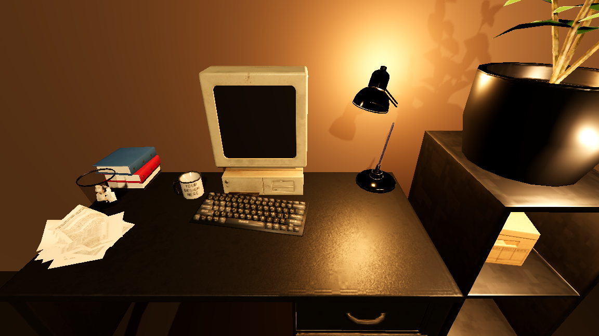
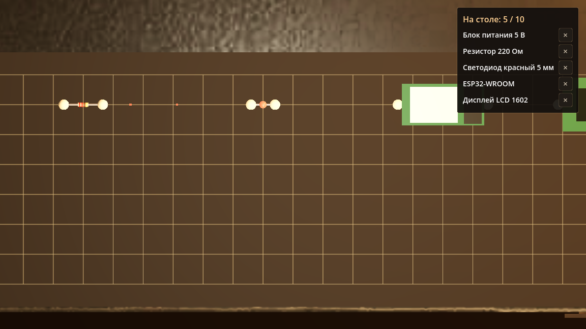

# esp.dll

Игра-симулятор отладочной станции (Godot 4.7): стол с ПК, мультиметром, Arduino и ESP.
Игрок читает задания, собирает электрические цепи, «прошивает» платы и меряет цепь мультиметром.

## Скриншоты

| Главное меню | Общий план стола |
| --- | --- |
|  |  |

| Экран ПК | Редактор сборки (вид сверху) | Каталог деталей |
| --- | --- | --- |
|  |  |  |

## Игровой цикл (MVP)

- Главное меню → игра (клик по столу / зум камерой на зоны).
- Наведение и клик по зонам: ПК, бумаги (чертежи), шкаф, зона сборки.
- Каталог из 31 реальной детали: клик — деталь появляется на столе.
- Сборка цепи: ортографический вид сверху, сетка 2 см, перетаскивание,
  поворот на 90° (R), провода от пина к пину.
- Симуляция тока: узловой анализ (MNA), LED с порогом и внутренним
  сопротивлением, параллельные/последовательные цепи — `Scripts/sim/circuit_sim.gd`.
- Виртуальная Arduino: подмножество C (`pinMode`, `digitalWrite`, `analogRead`,
  `delay`, `if`, `for`), компилятор с ошибками на русском — `Scripts/sim/arduino_vm.gd`.
- ESC на общем плане — возврат в меню.

## Запуск

```bash
godot --path .          # или откройте project.godot в Godot 4.7+
```

## Headless-верификация

```bash
godot --headless --path . --import
GODOT_VERIFY=menu godot --headless --path .
GODOT_VERIFY=back_to_menu godot --headless --path . res://game.tscn
godot --headless --path . --script res://verify_sim.gd    # VERIFY-OK sim
godot --headless --path . --script res://verify_bench.gd  # VERIFY-OK bench
godot --headless --path . --script res://verify_code.gd   # VERIFY-OK code
```

## Дорожная карта

См. `TASKS.md`: мультиметр (щупы, DCV/Ω/прозвонка), ESP-плата, UART-связь плат,
задания и сохранение прогресса.
