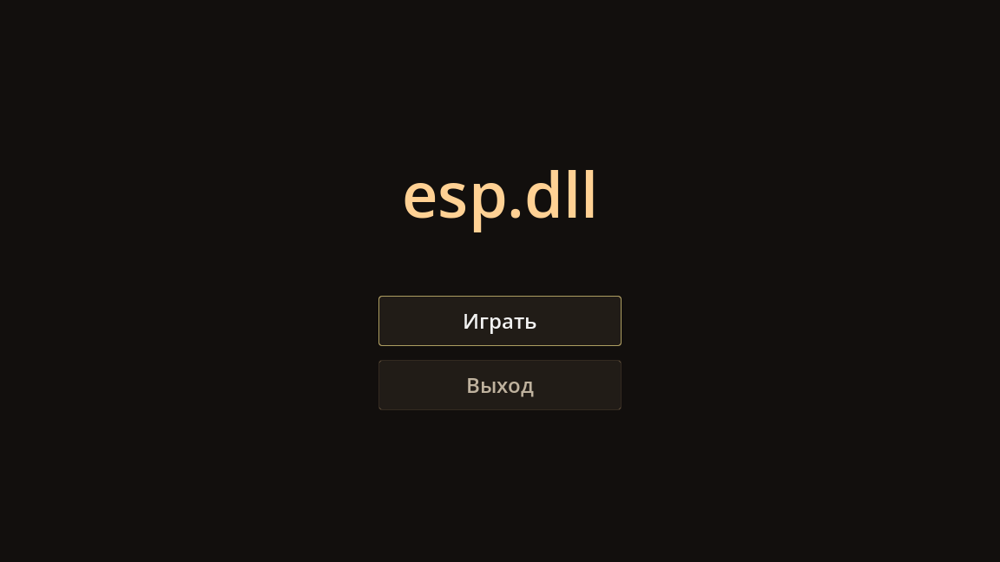
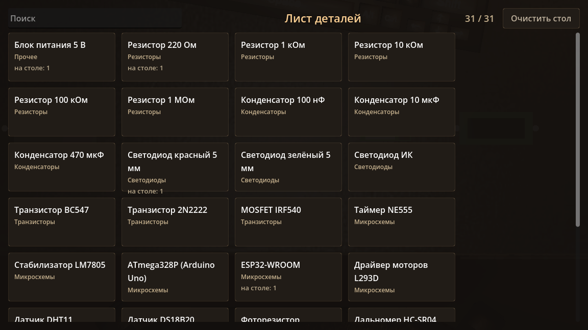

# esp.dll

Игра-симулятор отладочной станции (Godot 4.7): стол с ПК, мультиметром, Arduino и ESP.
Игрок читает задания, собирает электрические цепи, «прошивает» платы и меряет цепь мультиметром.

## Скриншоты

| Главное меню | Общий план стола |
| --- | --- |
|  |  |

| Экран ПК | Редактор сборки (вид сверху) | Каталог деталей |
| --- | --- | --- |
|  |  |  |

## Игровой цикл (MVP)

- Главное меню → игра (клик по столу / зум камерой на зоны).
- Мигание-подсказка: сначала пульсируют бумаги (чертёж), после захода туда —
  пульсирует шкаф (каталог); мигание гаснет при заходе в зону.
- Наведение и клик по зонам: ПК, бумаги (чертёж), шкаф (каталог), сборка.
- Каталог из 31 детали: клик — деталь появляется на столе.
- Сборка цепи: фиксированный ортографический вид сверху (зум резкий, без полёта),
  сетка 2 см, перетаскивание, поворот на 90° (R), провода от пина к пину (выбор
  начала/конца — клик и отпускание ЛКМ).
- Симуляция тока: узловой анализ (MNA), LED с порогом и внутренним
  сопротивлением, параллельные/последовательные цепи — `Scripts/sim/circuit_sim.gd`.
- Виртуальная Arduino: подмножество C (`pinMode`, `digitalWrite`, `delay`,
  комментарии), компилятор с ошибками на русском — `Scripts/sim/arduino_vm.gd`
  (`analogRead`, `if`, `for`, переменные — в дорожной карте, TASKS 4.2).
- Редактор кода — полноэкранный; «Загрузить на плату» работает только когда
  плата на столе (иначе редактор подскажет, что её не хватает).
- Скетч продолжает исполняться после закрытия редактора: LED на столе мигает,
  пока не загрузишь новый код (или не сменишь сцену).
- На чертеже — ровно один Arduino-контур: пин 13 → резистор 220 Ом → LED → GND.
- Один ESC закрывает оверлей и уводит камеру; ESC на общем плане — возврат в меню.

## Запуск

```bash
godot --path .          # или откройте project.godot в Godot 4.7+
```

## Сборка релиза

```bash
godot --headless --path . --export-release "Windows Desktop" build/windows/esp.dll.exe
```

Пресет `Windows Desktop` (x86_64, встроенный PCK) лежит в `export_presets.cfg`;
каталог `build/` в git не попадает.

## Headless-верификация

```bash
godot --headless --path . --import
GODOT_VERIFY=menu godot --headless --path .
GODOT_VERIFY=back_to_menu godot --headless --path . res://game.tscn
godot --headless --path . --script res://verify_sim.gd    # VERIFY-OK sim
godot --headless --path . --script res://verify_bench.gd  # VERIFY-OK bench
godot --headless --path . --script res://verify_code.gd   # VERIFY-OK code
godot --headless --path . --script res://verify_mvp.gd    # VERIFY-OK mvp
godot --headless --path . --script res://verify_input.gd  # клики/тяга провода
```

## Дорожная карта

См. `TASKS.md`: мультиметр (щупы, DCV/Ω/прозвонка), ESP-плата, UART-связь плат,
задания и сохранение прогресса.
